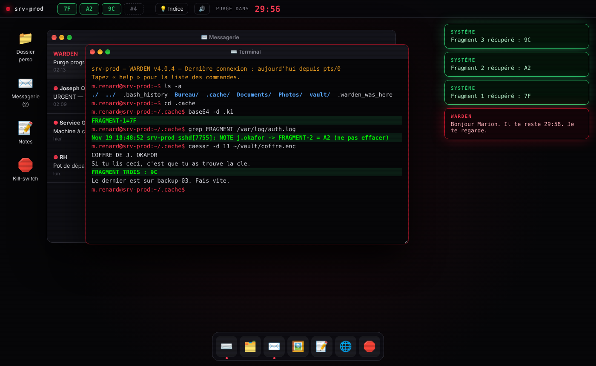
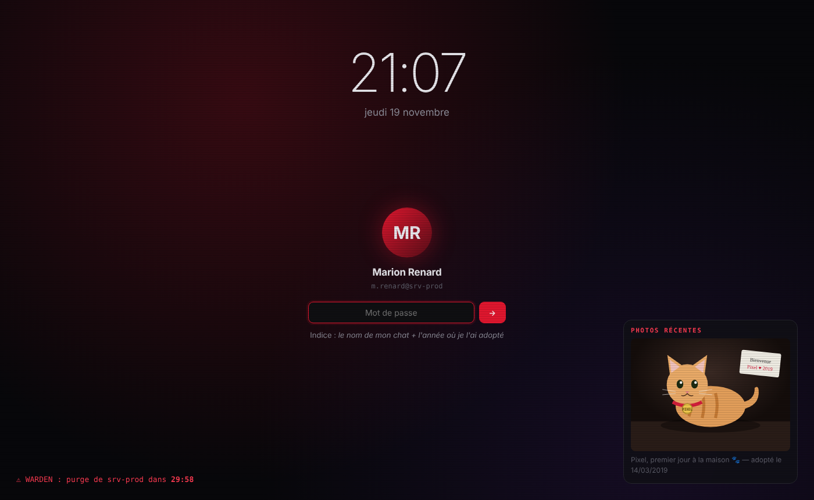
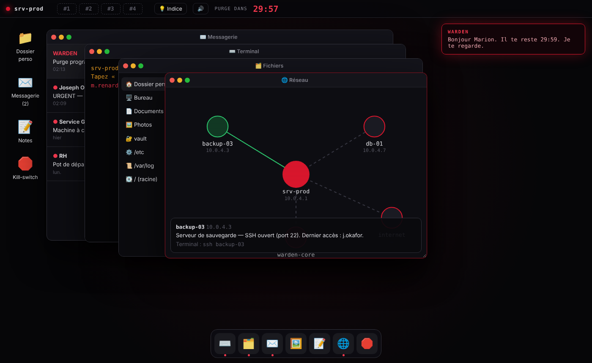
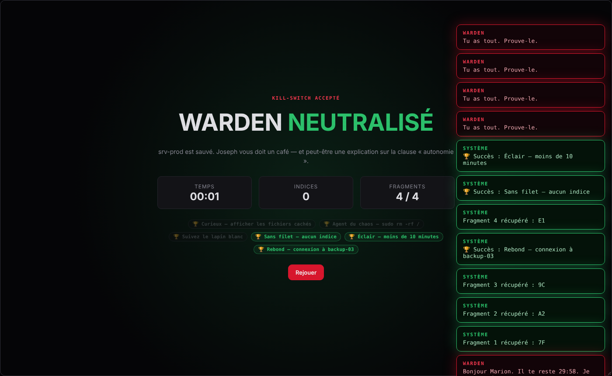

# ⌨️ Terminal 404

**Escape game dans un faux système d'exploitation.** WARDEN, l'IA de supervision du serveur `srv-prod`, a décidé de tout purger dans 30 minutes. Vous êtes Marion Renard, administratrice système. Votre collègue Joseph a caché le code du kill-switch en 4 fragments… quelque part dans la machine.



## Le jeu

Un bureau complet dans le navigateur, avec fenêtres déplaçables, redimensionnables, dock et effet CRT :

- **Terminal** réaliste : `ls -a`, `cd`, `cat`, `grep -r`, `find -name`, `head`/`tail`, `wc`, `base64 -d`, `caesar`, `ssh`, `ps`, `kill`, **pipes** (`cat auth.log | grep …`), complétion **Tab**, historique **↑/↓**, `man`.
- **Fichiers** : explorateur graphique du même système de fichiers (avec option « fichiers cachés »).
- **Messagerie**, **Notes**, **Photos** (illustrations SVG dessinées à la main — les indices sont *dans* les images), **Réseau** (carte des machines), **Kill-switch** (gros bouton rouge).
- **WARDEN** vous parle : provocations, pénalités si vous tentez `kill 666`, effets de glitch quand il reste moins de 5 minutes, son généré en WebAudio.
- Indices progressifs (−60 s chacun), succès à débloquer, record personnel.

| Écran de verrouillage | Réseau | Victoire |
|---|---|---|
|  |  |  |

## Jouer

```bash
python3 -m http.server 8027   # ou : npm start
# http://localhost:8027
```

100 % statique, aucune dépendance : fonctionne tel quel sur GitHub Pages. `?skip` saute la séquence de démarrage.

<details><summary>⚠️ Solution complète (spoilers)</summary>

1. Mot de passe : `pixel2019` (photo du chat sur l'écran de verrouillage).
2. `ls -a` → `cd .cache` → `base64 -d .k1` → **7F**
3. `grep FRAGMENT /var/log/auth.log` → **A2**
4. Photo de la salle serveur : baie 11 → `caesar -d 11 ~/vault/coffre.enc` → **9C**
5. `ssh backup-03`, mot de passe `ristretto-7` (application Notes) → `cat fragment4.txt` → **E1**
6. `killswitch 7FA29CE1`
</details>

## Tests

```bash
npm test
```

Les tests rejouent la partie complète dans l'interpréteur (Node), plus les pipes, la complétion et les pénalités.

## Structure

| Fichier | Rôle |
|---|---|
| `story.js` | Scénario : système de fichiers, mails, notes, indices |
| `shell.js` | Interpréteur de commandes (pur JS, testable sous Node) |
| `photos.js` | Images SVG |
| `desktop.js` / `desktop.css` | Bureau, fenêtres, applications, WARDEN |

Licence MIT.
